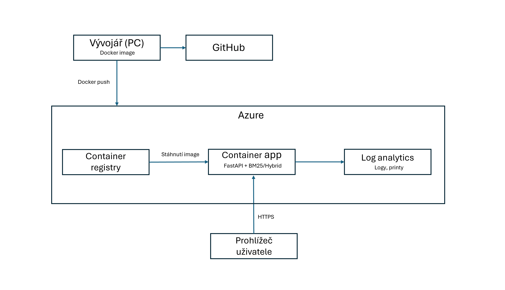

# Hybrid Search – vyhledávání v českých zpravodajských článcích

Vyhledávač nad 1000 českými zpravodajskými články.

Řešení vznikalo ve dvou fázích:

1. **BM25 (fulltextové vyhledávání).** Nejdříve jsem implementoval klasické
   vyhledávání BM25 včetně předzpracování češtiny (odstranění interpunkce, tokenizace, lemmatizace, malá písmena, odstranění diakritiky, odstranění stopslov, stemming)
2. **Hybridní vyhledávání.** Na základě pomocných výsledků evaluačních metrik jsem projekt
   rozšířil o hybridní vyhledávání, které kombinuje BM25 s embeddingy modelu
   `BAAI/bge-m3`. Výsledky obou metod se spojují pomocí Reciprocal Rank Fusion (RRF).

## Struktura projektu

| Soubor | Popis |
|---|---|
| `_data.ipynb` | průzkum a úprava datasetu |
| `preprocessing.py` | odstranění interpunkce, tokenizace, lemmatizace, malá písmena, odstranění diakritiky, odstranění stopslov, stemming |
| `bm25.py` | implementace BM25 |
| `embeddings.py` | embeddingy článků a dotazů (bge-m3) |
| `hybrid.py` | hybridní vyhledávání (BM25 + embeddingy, RRF) |
| `main.py` | webová aplikace (FastAPI) s vyhledáváním BM25 |
| `evaluate_bm25.py`, `evaluate_hybrid.py` | LLM vygenerované pomocné skripty pro evaluaci na testovacích dotazech |
| `eval/` | testovací dotazy |
| `results/` | výsledky evaluace |

### Co se indexuje

Každý článek se pro vyhledávání skládá ze tří polí: `headline`, `brief` a `content`.

- **BM25:** pole se spojí mezerou (`headline + " " + brief + " " + content`) a poté
  projdou předzpracováním.
- **Embeddingy (bge-m3):** pole se spojí s oddělením řádků
  (`headline + "\n" + brief + "\n\n" + content`), aby model rozlišil titulek,
  perex a tělo článku.

### Jak vyhledávání funguje

#### 1. Předzpracování textu (`preprocessing.py`)

Stejná funkce `preprocess()` se použije na články i na dotazy (jen pro BM25):

1. **Odstranění interpunkce**
2. **Tokenizace** 
3. **Lemmatizace**
4. **Malá písmena.**
5. **Odstranění diakritiky** 
6. **Odstranění stopslov** 
7. **Stemming** 

#### 2. Indexace článků

- **BM25 (`bm25.py`)** – pro každý článek se uloží slovník četností slov
  `{slovo: počet}` a délka článku. Pro celý korpus se spočítá, v kolika článcích se
  každé slovo vyskytuje, a průměrná délka článku.

- **Embeddingy (`embeddings.py`)** – každý článek se modelem `BAAI/bge-m3` převede na
  normalizovaný vektor o 1024 číslech. Vznikne hustá matice **1000 × 1024**, která se
  uloží do `artifacts/embeddings.npy`, aby se nemusela počítat znovu. Model čte
  maximálně 1024 tokenů; delší články se oříznou, díky pořadí
  headline → brief → content se ale vždy zachová titulek a perex.

#### 3. Vyhledávání

- **BM25** – dotaz projde předzpracováním a pro každý článek se spočítá BM25 skóre
  (`k1 = 1.5`, `b = 0.75`). Vrátí se články se skóre > 0 seřazené sestupně.
- **Embeddingy** – dotaz se tím samým modelem převede na vektor (1024,). Kosinová
  podobnost se všemi články se spočítá jedním násobením matice
  `embeddings @ query_vector` 

#### 4. Hybrid – spojení výsledků (`hybrid.py`)

1. Z BM25 i z embeddingů se vezme **100 nejlepších článků**.
2. Pořadí se spojí pomocí **Reciprocal Rank Fusion**:
   `skóre = 0.3 / (60 + pořadí v BM25) + 0.7 / (60 + pořadí v embeddingech)`.
3. Výsledky se seřadí podle skóre a vrátí se top N.

#### Webová aplikace (`main.py`)

Aplikace nasazená na Azure používá kvůli nákladům jen BM25 (kroky 1–3 bez
embeddingů).

## Evaluace

Evaluace je typu **known-item**: každý testovací dotaz má přesně jeden správný článek
(`doc_id`) a měří se, na kolikátém místě ho vyhledávač vrátí v top 10.

- `evaluate_bm25.py` – BM25 se spustí se 7 variantami předzpracování
  preprocessingu (kroky se postupně zapínají) a měří se přínos každého kroku.
  Výsledek: `results/results_bm25.csv`.
- `evaluate_hybrid.py` – srovnání BM25, embeddingů (bge-m3) a hybridu (RRF s různými
  váhami) na stejných dotazech a metrikách, včetně párového srovnání s 95% bootstrap
  intervalem spolehlivosti. Výsledky: `results/results.csv`,
  `results/paired_comparison.csv`, `results/per_query.csv`.

Dotazy i články procházejí vždy **stejnou** variantou předzpracování, jinak by se
tokeny dotazu a článku nemohly shodovat.

### Testovací sady (`eval/`)

| Soubor | Počet | Pole | Popis |
|---|---|---|---|
| `queries_known_item.json` | 240 | `query`, `doc_id`, `type` | ručně psané, přirozené dotazy |
| `queries_hard.json` | 500 | `query`, `doc_id`, `type` | těžké dotazy s malým překryvem slov s titulkem a perexem, jiné články než ruční sada |
| `queries_keywords.json` | 200 | `query`, `doc_id` | automaticky vytvořené z klíčových slov článků (sloupec `keywords`) |
| `queries_category.json` | 50 | `query`, `category` | obecné dotazy, např. „hokejová reprezentace“ → očekávaná kategorie `Sport` |

Pátá sada **„ruční bez diakritiky“** se nenačítá ze souboru, vzniká v kódu ze sady
`queries_known_item.json` odstraněním diakritiky. Simuluje uživatele, který píše bez
háčků a čárek.

**Poznámka k původu dat:** Testovací sady byly vygenerovány pomocí LLM. Nejde tedy o přesné měření kvality vyhledávání v reálném provozu, ale o
orientační srovnání: slouží hlavně k tomu, abych viděl, jestli a jak moc se
vyhledávání zlepšuje mezi jednotlivými variantami (předzpracování, BM25, embeddingy,
hybrid). Absolutní hodnoty metrik je proto potřeba brát s rezervou.

### Typy dotazů (pole `type`)

| `type` | Co testuje | Příklady dotazů z testovacích sad |
|---|---|---|
| `lexical` | dotaz používá stejná slova jako článek | „výstava Josef Váchal“, „letiště Vodochody nebude“ |
| `short` | krátký dotaz (1–3 slova) | „Hřebeč“, „Bechný“ |
| `typo` | překlepy | „skoda enyak cena prodej“, „twiter klubhouse akvizice“ |
| `derived` | odvozená slova | „Avast fúzuje s Nortonem ekonom lituje“, „radilův návrat do pardubic z ruska“ |
| `synonym` | jiná slova se stejným významem | „rozvoz kanabisu přes Uber v Kanadě“, „útok střelce v dánském obchodním domě“ |
| `paraphrase` | celá myšlenka formulovaná jinak | „kdo převzal vedení PPF po smrti zakladatele“, „zesnul bývalý manžel špinarové, rakovina plic“ |
| `colloquial` | hovorová čeština | „proč jsou papriky tak drahý“, „lenny a týpek z linkinů spolu udělali singl“ |
| `question` | dotaz ve formě otázky (jen v těžké sadě) | „kde odehráli naši zápas s estonci místo tallinnu“, „hrozí po zákazu ruské ropy v Evropě nedostatek nafty?“ |

### Metriky

Pro každý dotaz se spočítají metriky z pozice správného článku v top 10 a pak se
zprůměrují přes celou sadu. Příklad: správný článek je na **3. místě**.

| Metrika | Výpočet | Příklad (3. místo) | Význam |
|---|---|---|---|
| **MRR@10** | 1 / pořadí | 0,33 | hlavní metrika, trestá každé místo pod prvním |
| **R@1** | je na 1. místě? | 0 | trefa hned napoprvé |
| **R@5** | je v top 5? | 1 | uživatel článek uvidí bez scrollování |
| **R@10** | je v top 10? | 1 | článek se vůbec našel |
| **nDCG@10** | 1 / log₂(pořadí + 1) | 0,5 | jako MRR, ale mírnější trest za nižší místa |
| **P@10** | podíl článků se správnou kategorií v top 10 | – | jen pro `queries_category.json` |

Když správný článek v top 10 není, jsou všechny metriky dotazu 0. U sad s polem
`type` se MRR@10 počítá navíc zvlášť pro každý typ dotazu.

### Výsledky BM25 – varianty předzpracování

Varianty (kroky se postupně přidávají):

| Varianta | Předzpracování |
|---|---|
| 0 baseline | jen odstranění interpunkce a tokenizace |
| 1 + malá písmena | + převod na malá písmena |
| 2 + bez diakritiky | + odstranění diakritiky |
| 3 + stopwords | + odstranění stopslov |
| 4 + lemmatizace | + lemmatizace |
| 5 + stemming (full) | + stemming (= `preprocess()` v projektu) |
| 6 stemming bez lemmatizace | jako 5, ale bez lemmatizace |

MRR@10 podle sady (P@10 u kategorií):

| Varianta | ruční | ruční bez diakritiky | keywords | těžké (500) | kategorie P@10 |
|---|---|---|---|---|---|
| 0 baseline | 0.738 | 0.477 | 0.537 | 0.418 | 0.742 |
| 1 + malá písmena | 0.767 | 0.498 | 0.718 | 0.632 | 0.760 |
| 2 + bez diakritiky | 0.802 | 0.802 | 0.723 | 0.669 | 0.758 |
| 3 + stopwords | 0.804 | 0.804 | 0.723 | 0.665 | 0.760 |
| 4 + lemmatizace | 0.890 | 0.792 | 0.839 | 0.749 | 0.812 |
| **5 + stemming (full)** | **0.923** | 0.899 | **0.848** | **0.806** | **0.814** |
| 6 stemming bez lemmatizace | 0.906 | **0.906** | 0.846 | 0.787 | 0.812 |

MRR@10 podle typu dotazu, baseline vs. plné předzpracování:

| `type` | ruční: baseline | ruční: full | těžké: baseline | těžké: full |
|---|---|---|---|---|
| lexical | 0.921 | 0.971 | – | – |
| short | 0.911 | 1.000 | – | – |
| typo | 0.423 | 1.000 | 0.196 | 0.893 |
| derived | 0.762 | 0.960 | 0.414 | 0.887 |
| colloquial | 0.623 | 0.875 | 0.320 | 0.748 |
| paraphrase | 0.785 | 0.902 | 0.476 | 0.804 |
| synonym | 0.666 | 0.840 | 0.513 | 0.757 |
| question | – | – | 0.521 | 0.815 |

Hlavní zjištění:

- **Plné předzpracování (varianta 5) je nejlepší téměř všude.** Oproti baseline zvýší
  MRR@10 o +0.19 (ruční), +0.42 (bez diakritiky), +0.31 (keywords) a +0.39 (těžké).
- **Převod na malá písmena** výrazně pomůže u keywords (0.537 → 0.718) a těžkých
  dotazů (0.418 → 0.632), kde jsou jména často psaná malými písmeny, zatímco
  v článcích velkými.
- **Odstranění diakritiky** má největší efekt na dotazy bez háčků a čárek
  (0.498 → 0.802).
- **Odstranění stopslov** nemá téměř žádný vliv (změny do ±0.004). BM25 časté slova
  sám potlačuje přes IDF.
- **Lemmatizace** je největší jednotlivé zlepšení u ručních dotazů (0.804 → 0.890)
  a pomáhá hlavně u odvozených tvarů slov. U dotazů bez diakritiky ale mírně
  škodí (0.804 → 0.792), protože lemmatizátor slova bez háčků nepozná. To vyrovná
  až stemming.
- **Stemming** přidává další zlepšení nad lemmatizací (ruční 0.890 → 0.923, těžké
  0.749 → 0.806). S plným předzpracováním dosáhnou ruční `typo` 1.000 a `derived`
  0.960 (baseline 0.423 a 0.762).
- **Stemming bez lemmatizace (varianta 6)** je skoro stejně dobrý, na dotazech bez
  diakritiky dokonce o kousek lepší, ale na těžké sadě horší (0.787 vs. 0.806). Proto
  projekt používá variantu 5.
- **Slabina BM25 zůstává u dotazů jinými slovy**: synonyma (0.840 / 0.757),
  hovorová čeština a parafráze v těžké sadě. BM25 umí najít jen shodná slova, ne
  shodný význam. To byl důvod pro rozšíření o hybridní vyhledávání s embeddingy.

### Výsledky: BM25 vs. embeddingy vs. hybrid

Srovnávané systémy:

- **BM25 (full)** – BM25 s plným předzpracováním.
- **Embeddingy (bge-m3)** – jen sémantické vyhledávání: kosinová podobnost vektoru
  dotazu a vektorů článků.
- **Hybrid (RRF)** – z BM25 i z embeddingů se vezme 100 nejlepších článků a pořadí se
  spojí pomocí Reciprocal Rank Fusion:
  `skóre = w_bm25 / (60 + pořadí v BM25) + w_dense / (60 + pořadí v embeddingech)`.
  Spojují se pořadí, ne skóre, protože skóre BM25 a kosinová podobnost nejsou
  srovnatelné. Testovaly se váhy embeddingů `dense` = 0.5 (bez vah) až 0.9,
  váha BM25 je `1 - dense`.

MRR@10 podle sady (P@10 u kategorií):

| Systém | ruční | ruční bez diakritiky | keywords | těžké (500) | kategorie P@10 |
|---|---|---|---|---|---|
| BM25 (full) | 0.923 | 0.899 | **0.848** | 0.806 | 0.814 |
| embeddingy (bge-m3) | 0.977 | 0.952 | 0.711 | **0.962** | 0.814 |
| hybrid RRF (dense = 0.5) | 0.956 | 0.940 | 0.802 | 0.903 | **0.832** |
| hybrid RRF (dense = 0.6) | 0.970 | 0.954 | 0.791 | 0.917 | **0.832** |
| **hybrid RRF (dense = 0.7)** – použitý v `hybrid.py` | 0.973 | 0.958 | 0.783 | 0.931 | **0.832** |
| hybrid RRF (dense = 0.8) | 0.976 | 0.959 | 0.768 | 0.938 | **0.832** |
| hybrid RRF (dense = 0.9) | **0.978** | **0.960** | 0.746 | 0.954 | 0.830 |

MRR@10 podle typu dotazu na těžké sadě (500 dotazů):

| `type` | BM25 (full) | embeddingy | hybrid (dense = 0.7) |
|---|---|---|---|
| colloquial | 0.748 | **0.943** | 0.924 |
| derived | 0.887 | **1.000** | 0.962 |
| paraphrase | 0.804 | **0.975** | 0.936 |
| question | 0.815 | **0.913** | 0.868 |
| synonym | 0.757 | **0.976** | 0.912 |
| typo | 0.893 | 0.944 | **0.980** |

#### Párové srovnání

Pro každý dotaz se spočítá rozdíl MRR@10 mezi dvěma systémy a z rozdílů se pomocí
bootstrapu (2000 převzorkování) určí 95% interval spolehlivosti. **Když interval
neobsahuje 0, rozdíl je statisticky významný**, jinak může jít o náhodu. Sloupec
„lepší / horší / stejně“ udává počet dotazů, kde se nový systém zlepšil, zhoršil nebo
zůstal stejný.

| Srovnání | Sada | ΔMRR@10 | 95% CI | lepší / horší / stejně |
|---|---|---|---|---|
| embeddingy vs. BM25 (full) | ruční | +0.054 | [+0.025, +0.085] | 25 / 6 / 209 |
| | keywords | −0.137 | [−0.188, −0.087] | 16 / 56 / 128 |
| | těžké | +0.156 | [+0.125, +0.187] | 122 / 20 / 358 |
| hybrid 0.7 vs. BM25 (full) | ruční | +0.050 | [+0.027, +0.074] | 25 / 3 / 212 |
| | ruční bez diakritiky | +0.060 | [+0.032, +0.089] | 32 / 5 / 203 |
| | keywords | −0.065 | [−0.111, −0.020] | 20 / 39 / 141 |
| | těžké | +0.124 | [+0.099, +0.150] | 122 / 13 / 365 |
| hybrid 0.7 vs. embeddingy | ruční | −0.004 | [−0.021, +0.013] | 3 / 6 / 231 |
| | ruční bez diakritiky | +0.006 | [−0.014, +0.028] | 11 / 8 / 221 |
| | keywords | +0.072 | [+0.047, +0.100] | 39 / 2 / 159 |
| | těžké | −0.031 | [−0.050, −0.013] | 13 / 34 / 453 |

Kompletní tabulky jsou v `results/results.csv` a `results/paired_comparison.csv`,
MRR@10 každého dotazu u každého systému v `results/per_query.csv`.

#### Hlavní zjištění

- **Embeddingy výrazně překonávají BM25 u přirozených a těžkých dotazů** (těžká sada
  0.806 → 0.962). Rozumí významu, takže zvládají synonyma, parafráze i hovorovou
  češtinu, kde BM25 selhává.
- **U dotazů z klíčových slov je naopak nejlepší BM25** (0.848 vs. 0.711 u embeddingů).
  Seznam jmen a pojmů bez souvislé věty („Maďarsko Péter márki-zay Viktor orbán“)
  embeddingy zachytí hůř než přesná shoda slov.
- **Hybrid spojuje silné stránky obou metod.** Na ručních dotazech je statisticky
  stejně dobrý jako embeddingy (rozdíl −0.004, interval obsahuje 0), na keywords je
  významně lepší než embeddingy (+0.072) a na těžkých dotazech výrazně lepší než BM25
  (+0.124). Na žádné sadě není nejhorší ze tří systémů. Proti nejlepšímu systému
  dané sady ztrácí málo (−0.065 proti BM25 na keywords, −0.031 proti embeddingům na
  těžké sadě), zatímco samotné embeddingy ztrácí na keywords −0.137 a samotné BM25
  na těžké sadě −0.156.
- **Hybrid je nejlepší u překlepů** (`typo` 0.980) a u kategorií (P@10 0.832).
- **Váha embeddingů je kompromis**: vyšší váha zlepšuje těžké dotazy
  (0.903 → 0.954), ale zhoršuje keywords (0.802 → 0.746). Váha **0.7** drží
  keywords výrazně nad samotnými embeddingy (0.783 vs. 0.711) a těžké dotazy blízko
  nim (0.931 vs. 0.962).
- **Cena hybridu**: na těžké sadě je o 0.031 horší než samotné embeddingy, nejvíc
  u synonym (`synonym` 0.912 vs. 0.976) a otázek (`question` 0.868 vs. 0.913). BM25
  u nich nenajde shodná slova, nebo se chytá slov z otázky, která o tématu článku
  nevypovídají, a do fúze tak přidává šum.
- **Závěr:** hybrid (dense = 0.7) má nejlepší průměr pro různé typy dotazů. Webová
  aplikace nasazená na Azure používá kvůli nákladům jen BM25 (bez GPU a 2+ GB modelu),
  hybrid běží lokálně.

## Možné nasazení do produkce  

Jak řešení běží v produkci na Azure:

1. **Vývojář (PC)** postaví Docker image (`docker build`) a kód nahraje na **GitHub**
2. Image se pomocí `docker push` nahraje do soukromého **Azure Container Registry**.
3. **Container App** si image z registru stáhne a spustí FastAPI aplikaci.
4. **Prohlížeč uživatele** posílá dotazy přes HTTPS
5. Výstup aplikace  se ukládá do **Log Analytics**.

Aktuálně nasazená verze používá jen BM25. Hybrid by v cloudu vyžadoval stroj s GPU
a model bge-m3 (2+ GB), takže je výrazně dražší a běží lokálně.
